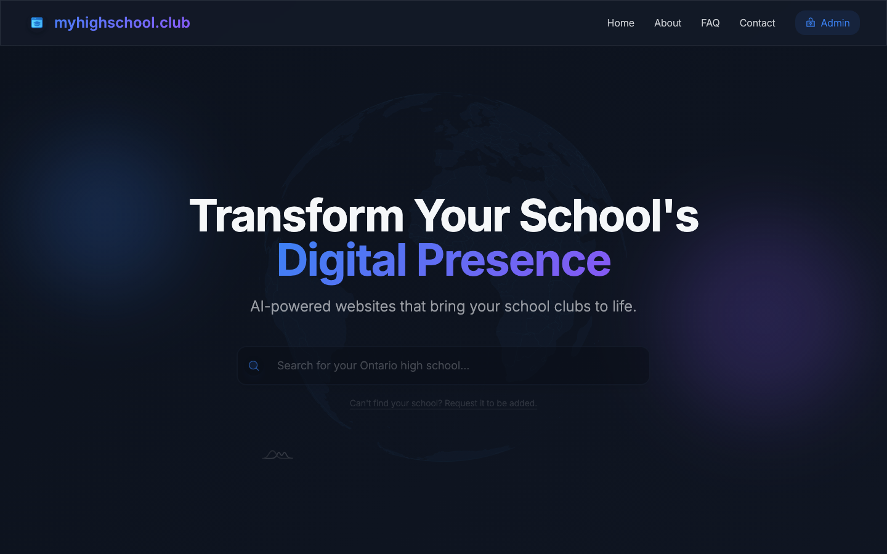
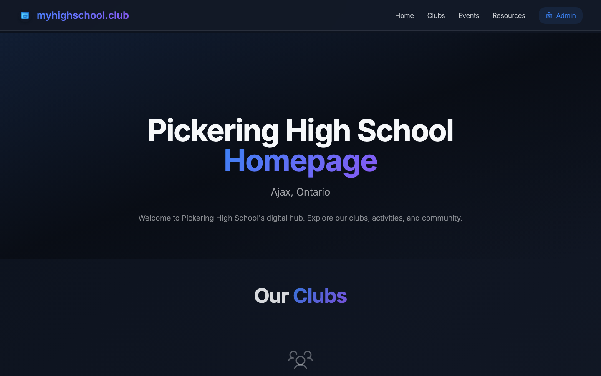

# myhighschool.club

[](https://github.com/anujmish1229/myhighschool.club/actions/workflows/ci.yml)

**Club websites for Ontario high schools, built in minutes.**
Student club leaders picked their school, chose a template and filled in a guided setup wizard.
Each club got a public site at `myhighschool.club/<school>/<club>`, and a school manager approved it before it went live.

> **Status: archived.** myhighschool.club ran from December 2025 to 2026 and has been wound down.
> The code and screenshots remain as a record of the project.



## Who it was for

- **Club leaders** who want a real website without writing code or paying for hosting.
- **Schools** that want every club listed in one place, with staff deciding what gets published.
- **Students and parents** looking for what clubs a school offers.

## Features

- **School search** across 250+ Ontario high schools, each with its own page listing its approved clubs.
- **Templates:** a multi-page club site (home, about, team, announcements, events calendar, gallery, FAQ), plus single-page DECA and Robotics themes.
- **Setup wizard and live editor:** branding colours, team members, announcements, events and FAQs, all stored as one JSON config per club.
- **Google sign-in** via Supabase Auth.
- **Approval workflow:** new clubs start as `pending`, and a manager for that school approves or rejects them from a manager dashboard.
- **Access control in the database:** Postgres Row Level Security decides who can read and write what, not the UI.



## My role

I founded the project and led development: product design, the React front end, the Supabase schema and Row Level Security policies, the school/manager approval workflow, and deployment. See [Contributors](#contributors) for the rest of the team.

## Architecture

```
Browser (React SPA, Vite)
   │  supabase-js (anon key + user JWT)
   ▼
Supabase
   ├── Auth ── Google OAuth
   └── Postgres + Row Level Security
        ├── templates        template catalog + default configs
        ├── schools          one row per club: school slug, club slug, owner, template, config JSON, status
        └── school_managers  (school slug, manager email) → who may approve clubs at that school
```

- **Routing.** `/:school` renders a school page, and `/:school/:club/*` loads that club's row and renders it with its template. The school list itself is static data (`src/data/ontarioSchools.ts`).
- **The school/manager model.** Any signed-in user can create a club, which they own. A club is visible to the public only once `status = 'approved'`, and only a manager listed in `school_managers` for that club's school can change its status. Managers are added from the Supabase dashboard (see [docs/ADMIN.md](docs/ADMIN.md)).
- **Security.** With no server of its own, the database enforces every rule. [`supabase/policies.sql`](supabase/policies.sql) limits public reads to approved clubs, lets owners edit only their own clubs, and stops them from approving themselves. It also limits managers to their own school.

## Tech stack

React 19 · TypeScript · Vite 8 · Tailwind CSS 4 · shadcn/ui (Radix) · Framer Motion · amCharts 5 (globe) · TanStack Query · React Router 7 · Supabase (Postgres, Auth, RLS) · Netlify · GitHub Actions CI

## Running locally

Requires Node 20.19+ or 22.12+ (see `.nvmrc`).

```bash
git clone https://github.com/anujmish1229/myhighschool.club.git
cd myhighschool.club
npm install
cp .env.example .env   # add your Supabase URL and anon key
npm run dev            # http://localhost:8080
```

**Why port 8080?** After Google sign-in, Supabase redirects back to
`<origin>/dashboard`, and it only redirects to URLs on the project's allow-list.
The allow-list contains `http://localhost:8080` and the production domain, so the
dev server is pinned to 8080 in `vite.config.ts`. On any other port, login fails.

### Environment variables

| Name | Purpose |
|---|---|
| `VITE_SUPABASE_URL` | Supabase project URL |
| `VITE_SUPABASE_ANON_KEY` | Supabase anon (public) key. It ships to the browser, so RLS is what protects the data. |

Never put the `service_role` key in this app.

To use your own Supabase project instead, follow [docs/SETUP.md](docs/SETUP.md).

| Command | |
|---|---|
| `npm run dev` | Dev server on port 8080 |
| `npm run build` | Production build to `dist/` |
| `npm run lint` | ESLint |
| `npm run typecheck` | TypeScript, no emit |

## Docs

- [docs/SETUP.md](docs/SETUP.md): create the database, configure Google OAuth, troubleshooting
- [docs/ADMIN.md](docs/ADMIN.md): roles, adding school managers, approving clubs

## Contributors

- **Anuj Mishra** ([@anujmish1229](https://github.com/anujmish1229))
- **Momin Shahid** ([@Endeyexe](https://github.com/Endeyexe))
- **Aaron Merchant** ([@aaronkoolkoder](https://github.com/aaronkoolkoder))
- **Victor Pollanen** ([@kimchiburgerss](https://github.com/kimchiburgerss))
